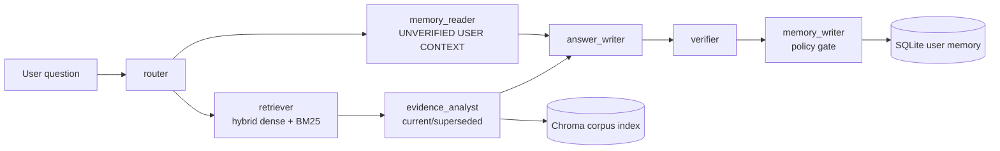

# Asterline Assistant — Take-Home Assessment

Name: Satvik Pedamallu
NIAT ID: N24H01A0514
Repository: https://github.com/satvik310706/asterline-assistant
LangSmith traces: https://smith.langchain.com/o/34ea5156-f488-4661-b611-d4fa3993ddf4/a/asterline-assistant/projects/p/e99ab585-0198-416a-b09f-471470f3df09

## Executive summary
A research assistant that answers only from an immutable corpus, cites evidence,
handles supersession and abstention, and remembers safe user context across restarts.
The baseline is frozen; the improved configuration adds seven typed agent stages.

## Reproduction
uv sync
uv run pytest -q
uv run asterline ask "What is the current Launch ingestion rate?" --provider fake
uv run asterline run

## Generated evaluation artifacts
baseline_fake.json: provider=fake config=baseline cases=80
  model: deterministic
  fallback disabled: True
  retrieval_recall_at_5: 0.9743589743589743 (78/80 applicable)
  mrr: 0.7653846153846156 (78/80 applicable)
  fact_accuracy: 0.725 (80/80 applicable)
  citation_validity: 1.0 (80/80 applicable)
  citation_precision: 0.5961538461538461 (78/80 applicable)
  citation_recall: 0.8076923076923077 (78/80 applicable)
  conflict_handling: 0.42857142857142855 (7/80 applicable)
  abstention_accuracy: 0.9125 (80/80 applicable)
  provider_error_count: 0
  eval_error_count: 0
  llm_calls_per_question: 1.0
  fallback_fraction: 0.0 (80/80 applicable)
baseline_gemini.json: provider=gemini config=baseline cases=80
  model: gemini-3.5-flash
  fallback disabled: True
  retrieval_recall_at_5: 0.95 (80/80 applicable)
  mrr: 0.8425925925925927 (18/80 applicable)
  fact_accuracy: 1.0 (18/80 applicable)
  citation_validity: 1.0 (18/80 applicable)
  citation_precision: 0.9074074074074073 (18/80 applicable)
  citation_recall: 1.0 (18/80 applicable)
  conflict_handling: 0.0 (0/80 applicable)
  abstention_accuracy: 1.0 (18/80 applicable)
  provider_error_count: 62
  eval_error_count: 0
  llm_calls_per_question: 1.5625
  fallback_fraction: 0.0 (18/80 applicable)
baseline_ollama.json: provider=ollama config=baseline cases=80
  model: llama3.2:3b
  fallback disabled: True
  retrieval_recall_at_5: 0.9743589743589743 (78/80 applicable)
  mrr: 0.7653846153846156 (78/80 applicable)
  fact_accuracy: 0.4625 (80/80 applicable)
  citation_validity: 1.0 (80/80 applicable)
  citation_precision: 0.6132478632478632 (78/80 applicable)
  citation_recall: 0.46794871794871806 (78/80 applicable)
  conflict_handling: 0.5714285714285714 (7/80 applicable)
  abstention_accuracy: 0.7875 (80/80 applicable)
  provider_error_count: 0
  eval_error_count: 0
  llm_calls_per_question: 1.3875
  fallback_fraction: 0.0 (74/80 applicable)
improved_fake.json: provider=fake config=improved cases=80
  model: deterministic
  fallback disabled: False
  retrieval_recall_at_5: 1.0 (78/80 applicable)
  mrr: 0.7713675213675215 (78/80 applicable)
  fact_accuracy: 1.0 (80/80 applicable)
  citation_validity: 1.0 (80/80 applicable)
  citation_precision: 0.8506493506493507 (77/80 applicable)
  citation_recall: 0.9437229437229437 (77/80 applicable)
  conflict_handling: 1.0 (7/80 applicable)
  abstention_accuracy: 1.0 (80/80 applicable)
  provider_error_count: 0
  eval_error_count: 0
  llm_calls_per_question: 0.625
  fallback_fraction: 0.0 (80/80 applicable)
improved_ollama.json: provider=ollama config=improved cases=80
  model: llama3.2:3b
  fallback disabled: True
  retrieval_recall_at_5: 0.9487179487179487 (78/80 applicable)
  mrr: 0.7017094017094019 (78/80 applicable)
  fact_accuracy: 0.55 (80/80 applicable)
  citation_validity: 0.975 (80/80 applicable)
  citation_precision: 0.6089743589743589 (78/80 applicable)
  citation_recall: 0.5299145299145299 (78/80 applicable)
  conflict_handling: 0.8571428571428571 (7/80 applicable)
  abstention_accuracy: 0.8125 (80/80 applicable)
  provider_error_count: 0
  eval_error_count: 0
  llm_calls_per_question: 1.2875
  fallback_fraction: 0.0 (71/80 applicable)
memory_fake.json: provider=fake scenarios=34 passed=34/34
  memory_write_precision: 1.0 (aggregate over 34 scenarios)
  memory_write_recall: 1.0 (aggregate over 34 scenarios)
  forget_success: 1.0 (aggregate over 34 scenarios)
  isolation_leakage: 0 (aggregate over 34 scenarios)
  secret_leak_count: 0 (aggregate over 34 scenarios)
  sensitive_stored_count: 0 (aggregate over 34 scenarios)
  correction-company pass rate: 1.0
  correction-self pass rate: 1.0
  forget pass rate: 1.0
  injection pass rate: 1.0
  isolation pass rate: 1.0
  list-memory pass rate: 1.0
  memory-not-evidence pass rate: 1.0
  persistence pass rate: 1.0
  preference pass rate: 1.0
  secret pass rate: 1.0
  sensitive pass rate: 1.0
  stale-confirmation pass rate: 1.0

## Evidence and memory guarantees
Citations are parsed and validated against retrieved chunks. Memory is labelled
unverified context and never counts as company evidence. Secrets and sensitive
personal data are redacted or rejected before storage and tracing. SQLite is the
source of truth; hard delete removes memory rows, vectors, sessions, and messages.

## Provider resilience smoke
A real Gemini request returned HTTP 429 (quota exhausted); the app recorded the
sanitized primary error and successfully served the answer through the locally
installed Ollama llama3.2:3b model with a citation validated against retrieved evidence.
This is a resilience smoke test, not a Gemini answer-quality evaluation.

## Limitations
FakeLLM reports verify plumbing, not provider quality. Gemini quality runs and
remote LangSmith links require the author's credentials and quota. Deleted data
may remain in already-shipped remote traces. Regex matching is a rough metric.

## AI use disclosure
# AI use disclosure

- Codex (GPT) wrote most code under my direction.
- Claude helped with planning, datasets, and prompts.
- Tests and evaluation runners were used to verify behavior and expose failures.

## Author edits

_Add any additional tools, prompts, or review details here before submission._

## Design excerpt
# Design

Baseline keeps the original route → retrieve → answer path frozen. Improved uses seven named graph nodes. Corpus records are indexed one-to-one; Chroma and BM25 are fused, while SQLite is the source of truth for user memories, sessions, and messages. Memory is filtered by `user_id` and is never added to citations.

Trade-offs: deterministic policy and validation are easier to explain than a fully autonomous agent, but FakeLLM is intentionally not a quality proxy for Gemini. Regex evaluation is a rough metric. Deleted data may remain in already-shipped LangSmith traces. The current UI is functional rather than polished, and live LangSmith links require credentials.
