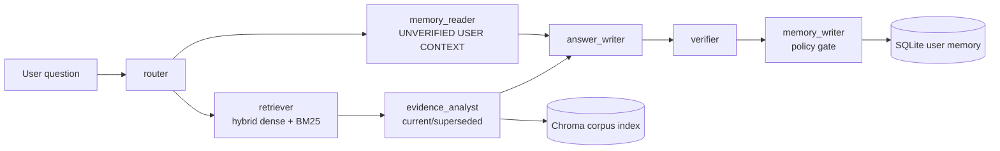

# Design

Baseline keeps the original route → retrieve → answer path frozen. Improved uses seven named graph nodes. Corpus records are indexed one-to-one; Chroma and BM25 are fused, while SQLite is the source of truth for user memories, sessions, and messages. Memory is filtered by `user_id` and is never added to citations.

Trade-offs: deterministic policy and validation are easier to explain than a fully autonomous agent, but FakeLLM is intentionally not a quality proxy for Gemini. Regex evaluation is a rough metric. Deleted data may remain in already-shipped LangSmith traces. The current UI is functional rather than polished, and live LangSmith links require credentials.
